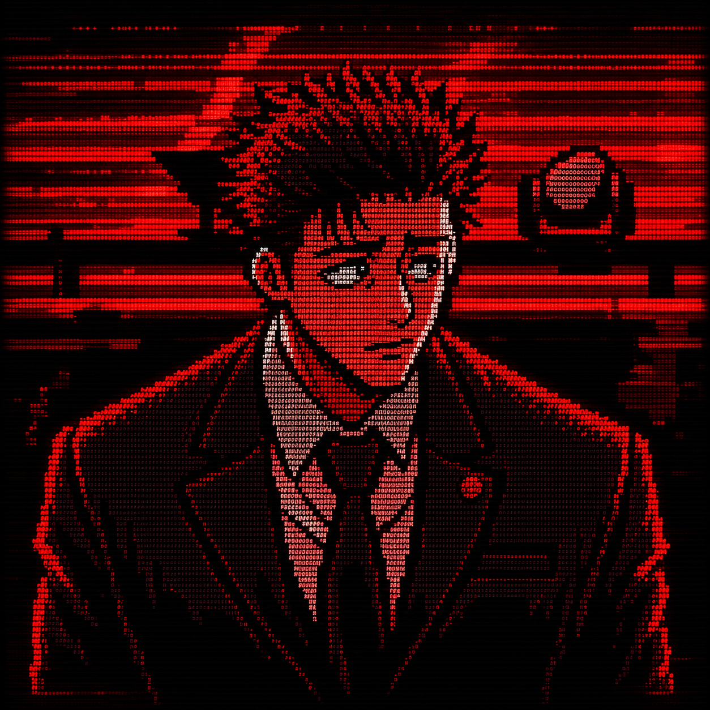

<table>
<tr>
<td width="42%" align="center" valign="middle">

</td>
<td width="58%" valign="middle">

<h3><code>satriyo@github</code></h3>

<pre>
--------------------------
OS       : Linux enthusiast
HOST     : satriodone500-hash
ROLE     : IT & Networking
FOCUS    : Linux / Rust / TCP-IP
INTEREST : Infrastructure
STATUS   : Always building
</pre>

Hey, I'm Satriyo.

IT stuff, Linux, networking, Rust, and random experiments.

I build things because it's more fun than just reading about them.

</td>
</tr>
</table>

### <code>PROGRAMMING LANGUAGES</code>

<code>~ Always learning. Always building. ~</code>

